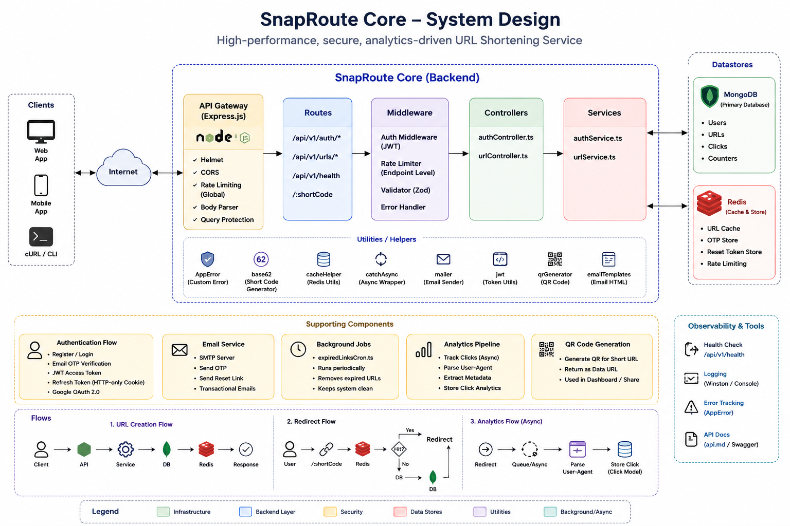

# SnapRoute — URL Shortening Service

SnapRoute is a full-stack URL shortener with a React dashboard and a TypeScript/Express API. Users can create and organize short links, protect them, set expiration dates, and review click analytics.



## Features

- Account registration, login, Google OAuth, email verification, and password recovery
- Short links with generated Base62 codes or custom aliases
- Tags, favorites, password protection, expiration, archive/restore, and deletion
- QR-code generation and redirect tracking
- Click analytics by date, device, browser, and operating system
- Redis caching, rate limiting, and expired-link cleanup
- Owner-protected URL management and analytics
- Health endpoint and interactive OpenAPI documentation

## Stack

- **Frontend:** React 19, TypeScript, Vite
- **API:** Node.js, Express 5, TypeScript
- **Storage:** MongoDB/Mongoose and Redis
- **Security:** JWT, HTTP-only refresh-token cookies, bcrypt, Zod, Helmet, rate limiting
- **Integrations:** Google OAuth and Brevo email (optional)

## Requirements

- Node.js 22.12 or newer
- pnpm 10.32.1 (the frontend is pinned to this package manager)
- Docker Compose, or locally running MongoDB and Redis

## Run locally

### 1. Start MongoDB and Redis

```sh
cd server
docker compose up -d
```

### 2. Start the API

In the `server/` directory:

```sh
cp .env.example .env
pnpm install
pnpm dev
```

The API runs at `http://localhost:5000`. Swagger UI is at `http://localhost:5000/api-docs`; the health endpoint is `http://localhost:5000/api/v1/health`.

MongoDB and Redis are required. Google OAuth and Brevo email delivery are optional; set their values in `server/.env` to enable those integrations. Use strong, unique secrets for production.

### 3. Start the dashboard

In a second terminal, from `frontend/`:

```sh
cp .env.example .env
pnpm install
pnpm dev
```

Open `http://localhost:5173`. The frontend `.env` controls `VITE_API_BASE_URL` and `VITE_SHORT_URL_BASE`. These are public browser settings; do not put secrets in them.

Use **pnpm** for this project. The frontend includes `pnpm-lock.yaml` and declares its package manager in `package.json`.

## Build and run

Build each package from its directory:

```sh
pnpm build
```

Run the compiled API from `server/` with `pnpm start`. Serve the frontend's generated `dist/` directory with a static web server. Keep `dist/`, `node_modules/`, and local `.env` files out of Git.

## API reference

The API base URL is `http://localhost:5000/api/v1`. See [api.md](api.md) for request and response details.

| Area | Base path | Access |
| --- | --- | --- |
| Authentication | `/auth` | Public routes and signed-in profile routes |
| Link management | `/urls` | Signed-in owner |
| Analytics | `/urls/:shortCode/analytics` | Link owner |
| Redirects | `/:shortCode` | Public |
| Health | `/health` | Public |

Protected routes use `Authorization: Bearer <access-token>`. The refresh token is stored in an HTTP-only cookie.

## Project structure

```text
12-url-shortening-service/
├── frontend/   React dashboard
├── server/     Express API, MongoDB/Redis services, and Docker Compose
├── api.md      API endpoint reference
└── README.md
```

See the [frontend guide](frontend/README.md) and [server guide](server/README.md) for package-specific details.
