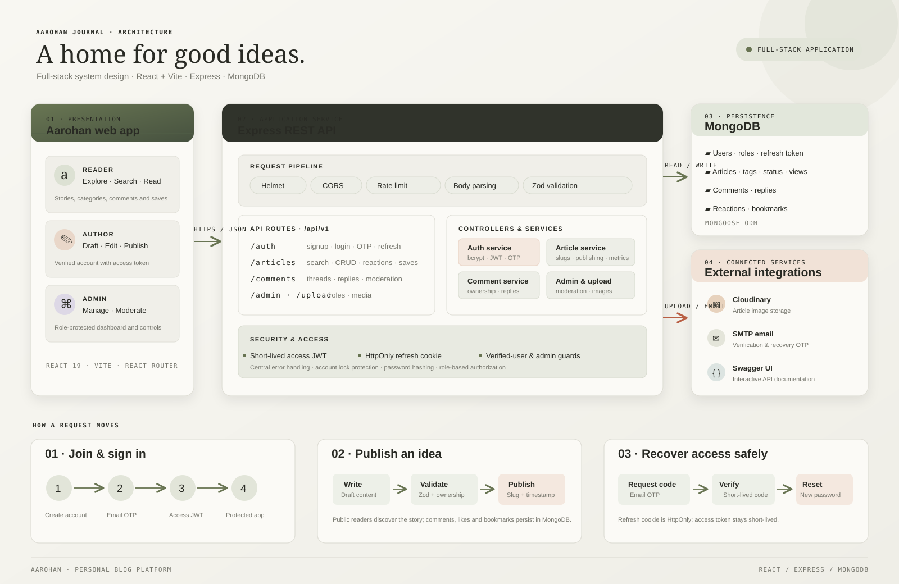

# Aarohan

A full-stack personal publishing platform with a React client and an Express API.



## Start locally

Use Node.js 20 or newer and MongoDB.

1. Configure the API:

   ```bash
   cd backend
   cp .env.example .env
   npm install
   npm run dev
   ```

2. Configure and start the client in a second terminal:

   ```bash
   cd frontend
   cp .env.example .env
   npm install
   npm run dev
   ```

The API is available at `http://localhost:5000`, Swagger documentation at
`http://localhost:5000/api-docs`, and the frontend at `http://localhost:5173`.
The backend environment template contains the required MongoDB and JWT settings.
SMTP is needed for email verification and password recovery; Cloudinary is only
needed for image uploads.

## Environment templates

- API: [`backend/.env.example`](backend/.env.example)
- Frontend: [`frontend/.env.example`](frontend/.env.example)
- URL shortener API: [`../12-url-shortening-service/server/.env.example`](../12-url-shortening-service/server/.env.example)
- URL shortener frontend: [`../12-url-shortening-service/frontend/.env.example`](../12-url-shortening-service/frontend/.env.example)

Do not commit real `.env` files or secrets.
